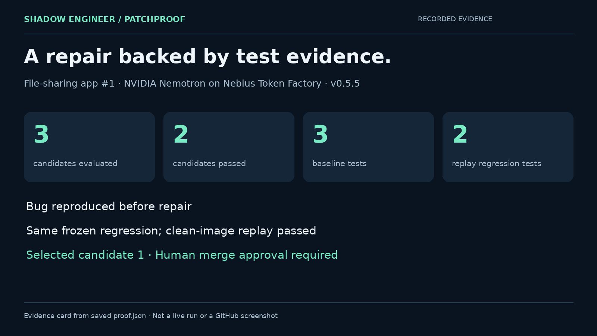

# Shadow Patch

**Label a bug. Review a repair backed by independent test evidence.**

Shadow Patch turns a labelled GitHub issue into a pull request whose fix was
proven first. It writes a regression test before asking for any patch, evaluates
candidate repairs in isolated **Nebius Sandbox** branches, replays the winner from
a clean image, and only then opens a PR. A human always decides whether to merge.
Nothing is ever auto-merged.

**Engine: v0.6.0-rc.39 · Track: Coding and Agentic Engineering · Models: NVIDIA Nemotron on Nebius Token Factory · License: [MIT](LICENSE)**

[Run it step by step](#run-shadow-patch-step-by-step) ·
[How Nebius and NVIDIA are used](#how-nvidia-nemotron-and-nebius-are-used) ·
[Recorded evidence](docs/EVIDENCE.md) · [Compatibility](docs/COMPATIBILITY.md) ·
[Architecture](docs/ARCHITECTURE.md) · [Demo script](docs/DEMO.md) ·
[Submission text](docs/SUBMISSION.md)



## What it does

1. A maintainer adds the `shadow-fix` label to an issue.
2. Shadow Patch checks the sandbox image, the runtime and the existing test baseline **before** any model call.
3. A verifier model drafts a regression test from the issue and shows it fails with a real assertion on the unfixed code.
4. Three solver strategies propose small, exact-match source edits. The new regression is hidden from them.
5. Each candidate runs in its own sandbox branch and must pass the existing tests and the frozen regression.
6. The winner (fewest files, then fewest lines, then fastest) is replayed from a clean sandbox image.
7. The workflow opens or updates one PR per issue, with a verification report. A human reviews and merges.

If any step fails, the run stops with a stated reason and **no PR is opened**. So far
there have been zero false accepts. See [Architecture](docs/ARCHITECTURE.md) for the
trust boundaries and limits.

## How NVIDIA Nemotron and Nebius are used

| Piece | What it does in Shadow Patch |
| --- | --- |
| **NVIDIA Nemotron** (open models) | Every model call is a Nemotron model: the verifier that writes the regression test, and the three solver strategies that propose repairs. The first recorded repair used `nvidia/Nemotron-3_5-Lightning`; the later repairs and all benchmark trials used `nvidia/nemotron-3-super-120b-a12b`. `nvidia/Nemotron-3-Ultra-550b` was also tried and was token-hungry. |
| **Nebius Token Factory** (inference) | `proof.py` calls the Token Factory OpenAI-compatible endpoint (`https://api.tokenfactory.nebius.com/v1/`) for the verifier, the specification step and every solver call. One Nebius API key covers inference and Sandboxes, so a whole run (one verifier plus three solvers, with retries) fits inside a single GitHub Actions job. |
| **Nebius Sandboxes** (via `contree-sdk`) | Repository bootstrap, baseline tests, the "does it fail before the fix" check, each candidate's isolated branch, and the clean-image replay all run in Sandboxes. Sandbox snapshots are what make separate verification stages practical. |
| **Nebius Sandbox images** | The **Prepare Sandbox Image** workflow builds the toolchain image (Node, pinned `tsx`/`typescript`/`jsdom`, plus Python, JVM, Go and Rust profiles) in a Sandbox. |
| GitHub Actions (not Nebius) | Orchestrates the run, applies the model's edit instructions on the runner, and opens the PR. Patch assembly happens on the runner, not inside Nebius. |

There is no latency or cost benchmark in this repository, so no speed-up figure is
claimed. The measured numbers (candidate counts, elapsed time per candidate,
replay results) are in each run's `proof.json`; see [recorded evidence](docs/EVIDENCE.md).

## Run Shadow Patch step by step

Shadow Patch runs as a GitHub Action in **your own repository**. Follow these steps
in order. You need a GitHub account and a Nebius account with Token Factory and
Sandbox (beta) access.

### Step 1. Check that your issue fits

Shadow Patch is not a general bug fixer. It fits a bug where "calling `f(<input>)`
returns `<actual>` but should return `<expected>`", in a TypeScript or Node
repository (best fit) or a small static site. Read [docs/RUN_GUIDE.md](docs/RUN_GUIDE.md)
section 1 (a two-minute table) before spending a run. Recorded evidence exists for
`node-typescript` and `node-package`; every other adapter is experimental. See
[docs/COMPATIBILITY.md](docs/COMPATIBILITY.md).

### Step 2. Get Nebius credentials

1. Create or open a Nebius Token Factory project with Sandbox beta access.
2. Create an API key that belongs to that project and has Sandbox permission. A key without Sandbox access fails with `403 Forbidden`.
3. Note the **project ID** and pick a model, for example `nvidia/nemotron-3-super-120b-a12b`.

### Step 3. Build a Sandbox image

The image holds the toolchain. Do this once.

1. In a repository that contains [`.github/workflows/prepare-image.yml`](.github/workflows/prepare-image.yml) (fork or copy this one), add the secrets `NEBIUS_API_KEY` and `NEBIUS_PROJECT_ID` under **Settings → Secrets and variables → Actions**.
2. Open **Actions → Prepare Sandbox Image → Run workflow**. Choose profile `web` for TypeScript, Node or static sites (or `all` for every toolchain).
3. When it finishes, copy the printed `UUID` from the job summary. It tells you which secret name to save it as (for TypeScript: `CONTREE_IMAGE_NODE_TYPESCRIPT`).

### Step 4. Prepare your target repository

For a `node-typescript` repository, check under **Node 20** (the Sandbox runs Node 20):

```bash
npm ci
npx tsc -p . --noEmit      # must exit 0
CI=1 npm test              # must pass and print "# tests N" with N >= 1
```

Pin `tsx` and `typescript` in `devDependencies`, commit the lockfile, and make `npm test` run
a new `tests/*.test.ts` file (for example `tsx --test tests/*.test.ts`). Optional preflight,
from a checkout of this repository:

```bash
python3 tools/preflight_base.py --path /path/to/your/repo --module src/foo.ts --export fooFn
```

It exits 0 when the repository is suitable. Details, the static-site checklist and the
exact failure each missed item causes are in [docs/RUN_GUIDE.md](docs/RUN_GUIDE.md) and
[docs/SETUP.md](docs/SETUP.md). If runtime detection is ambiguous, add a `patchproof.json` at the
repository root, for example `{"runtime": "node-typescript"}` (an example is in
[`examples/file-sharing-setup/`](examples/file-sharing-setup/)).

### Step 5. Add the secrets and settings to your target repository

Under **Settings → Secrets and variables → Actions**:

| Name | Type | Value |
| --- | --- | --- |
| `NEBIUS_API_KEY` | Secret | Your Nebius API key |
| `NEBIUS_PROJECT_ID` | Secret | Your Nebius project ID |
| `NEBIUS_MODEL` | Variable (or secret) | e.g. `nvidia/nemotron-3-super-120b-a12b` |
| `CONTREE_IMAGE_NODE_TYPESCRIPT` | Secret | UUID from Step 3 (use the secret name for your adapter, or `CONTREE_IMAGE` for a shared image) |

Then under **Settings → Actions → General**, enable *Allow GitHub Actions to create and
approve pull requests*. Never paste credentials into an issue, README or recording.

### Step 6. Add the workflow file

Copy [`examples/action-usage/shadow-fix.yml`](examples/action-usage/shadow-fix.yml) to
`.github/workflows/shadow-fix.yml` in your repository and commit it **to the default branch**.
The key part is:

```yaml
- uses: actions/checkout@v4
  with:
    fetch-depth: 0
- uses: creatoropener/shadow-patch@v0.6.0-rc.39   # pin an exact tag, never a branch
  with:
    nebius-api-key: ${{ secrets.NEBIUS_API_KEY }}
    nebius-project-id: ${{ secrets.NEBIUS_PROJECT_ID }}
    nebius-model: ${{ vars.NEBIUS_MODEL || secrets.NEBIUS_MODEL }}
    agent-mode: legacy
    image-node-typescript: ${{ secrets.CONTREE_IMAGE_NODE_TYPESCRIPT }}
```

No engine files are copied into your repository. Pass only the image input your adapter
needs. All inputs and outputs are listed in [docs/ACTION.md](docs/ACTION.md).

### Step 7. Write the issue and trigger the run

1. Create an issue that states the file and function, one concrete input, the exact expected output in a code block, and what must **not** change. See "Writing an issue the verifier can test" in [docs/ACTION.md](docs/ACTION.md).
2. Create the label named exactly `shadow-fix` (after the workflow is committed) and apply it to the issue.

### Step 8. Watch the run and read the result

1. Open **Actions → Shadow Patch**. The Action comments on the issue when it starts.
2. When it ends, open the job summary and the `patchproof-issue-<number>` artifact. It contains `proof.json` (machine-readable evidence) and `verification-report.md`.
3. The verdict is `verified`, `rejected` or `blocked`. On `verified`, the Action opens a PR on branch `shadow-fix/issue-<number>` and comments a link on the issue.
4. Review the source diff, the frozen regression test and the report in the PR. **Merge it yourself.** Re-labelling the same issue updates the same PR instead of creating a duplicate.

A green run alone is not evidence that a new PR exists: always check the PR link. If
something fails, the symptom table in [docs/SETUP.md](docs/SETUP.md) and section 6 of
[docs/RUN_GUIDE.md](docs/RUN_GUIDE.md) list the usual causes.

### Alternative: run the engine from the command line

To run the verification without GitHub Actions (no PR is opened), use Python 3.12 and a
checkout of the target repository:

```bash
git clone https://github.com/creatoropener/shadow-patch.git
python3 -m pip install -r shadow-patch/requirements-patchproof.txt

export NEBIUS_API_KEY=...        NEBIUS_PROJECT_ID=...
export NEBIUS_MODEL=nvidia/nemotron-3-super-120b-a12b
export CONTREE_IMAGE_NODE_TYPESCRIPT=<uuid from Step 3>

# Baseline checks only, no model request:
python3 shadow-patch/proof.py --repo /path/to/target --readiness-only

# Full run (writes proof.json and verification-report.md in the target repo):
python3 shadow-patch/proof.py --repo /path/to/target --issue-number 1 \
  --issue-title "Short title" --issue-body "Body with a concrete input and expected output"
```

### Try it without setting anything up

- The recorded, reviewable result: [issue #1](https://github.com/creatoropener/file-sharing-app/issues/1) → [PR #2](https://github.com/creatoropener/file-sharing-app/pull/2) → [workflow run](https://github.com/creatoropener/file-sharing-app/actions/runs/35464615209).
- A read-only evidence viewer: open `docs/demo/index.html`.
- To reproduce the demo in a fresh repository, follow [docs/DEMO.md](docs/DEMO.md). The unfixed revision is `807346b22421d0a58103092ccc318c1bdc1d7231` of `creatoropener/file-sharing-app`.

## Recorded repairs

Five repairs on four repositories reached a VERIFIED verdict and a pull request. All four
repositories are owned by the project, so these are development results, not evidence of
generalization. A later rc.39 run on file-sharing-app #1 also verified.

| Repair | Engine / adapter | What was wrong |
| --- | --- | --- |
| file-sharing-app #1 (PR #2) | v0.5.5, Node | Size and speed formatting printed raw template text |
| file-sharing-app #3 | v0.6.0-rc.12, `node-typescript` | Every P2P chunk failed its AES-GCM auth-tag check because the per-stream IV seed was never transmitted |
| QRcrafts #1 (PR #3) | v0.6.0-rc.15 and rc.20, `node-typescript` | WiFi QR codes did not escape the reserved characters `;` `,` `:` `\` and `"` |
| Tabloop #2 ([PR #3](https://github.com/creatoropener/Tabloop/pull/3)) | v0.6.0-rc.36, `static-web` | The contact form action `/thank-you.html` was root-absolute and broke subpath and staging deploys |
| Aegisscan #3 ([PR #4](https://github.com/creatoropener/Aegisscan-Bug-Auditor/pull/4)) | v0.6.0-rc.37, `node-typescript` | The SAST dependency scan missed vulnerable Axios versions such as `0.19.2` because its regex expected a quote right after the minor version |

All are recorded in [docs/EVIDENCE.md](docs/EVIDENCE.md). The first green run
evaluated **three candidates, two passing and one rejected**; the rejected one omitted
the space in `1.0 KB`, which the hidden regression caught. Clean replay passed three
baseline tests plus two regression tests. These are recorded results, not fresh tests
run during release packaging.

## Runtime scope

| Adapter | Toolchain | Evidence in this release |
| --- | --- | --- |
| `node-typescript` | Package baseline + pinned tsx + semantic lint + TypeScript checker + Node test runner | Recorded on the project's own repositories (file-sharing-app, QRcrafts, Aegisscan) |
| `node-package` | JavaScript package baseline + Node test runner | Recorded for the v0.5.5 repair only |
| `static-web` | Syntax check + Node/jsdom regression via the project's `node --test` | Experimental; one live success (Tabloop #2, rc.36, PR linked) after fixes in rc.35 to rc.39 |
| `python-pytest`, `web-playwright`, `java-junit`, `java-maven`, `java-gradle`, `go`, `rust` | Adapters included | No current-release live evidence; experimental |

One build root is selected per run. Passing a repository baseline does not establish
that a whole application builds or works. Known limits are in
[docs/ARCHITECTURE.md](docs/ARCHITECTURE.md).

## Benchmark: what it does and does not show

The v0.6.0-rc.21 engine was measured on a small benchmark with three trials per case.

| Split | Cases | Result for rc.21 |
| --- | --- | --- |
| Development (the engine was built against these) | QRcrafts #1, file-sharing-app #1 | **6/6** correct and accepted |
| Held-out (unseen repositories) | Aegisscan SSRF issue, Tabloop form-action issue | **0/6**: the verifier never accepted a test, so no repair was evaluated |

The engine works on the repositories it was developed against and **did not generalize**
to two unseen repositories at that time. Failures were on the verification side, with no
false accepts. Those two held-out cases have since become development cases. A new
held-out set has not been run, so no generalization claim is made. Tables and caveats:
[docs/BENCHMARK.md](docs/BENCHMARK.md).

## Repository map

- `proof.py`: inference, validation, candidates, replay and reports.
- `runtimes.py`: runtime detection, commands and native-result classification.
- `action.yml`: the reusable GitHub Action (`creatoropener/shadow-patch@<tag>`).
- `patchproof_runtime/`: engine-owned sandbox and test-plumbing helpers.
- `.github/workflows/`: image preparation, benchmark, engine checks and the issue-to-PR workflow.
- `bench/`: benchmark harness, manifest, protocols and labels.
- `examples/`: ready-to-copy workflow and target setup files.
- `docs/`: setup, architecture, recorded evidence and submission materials.
- `legacy/v0.2/`: preserved prototype; not the current entry point.

## Limitations

- **No generalization is shown.** Held-out was 0/6 on rc.21; all later verified repairs are on repositories the project owns.
- **The verifier is the weak point.** On unseen repositories the generated regression test was often refused before any repair was evaluated.
- **Scope must be configured.** `scope.allowed_paths` and `scope.protected_symbols` constrain edits; without them scope is reported as unrestricted.
- **Single TypeScript project.** Project-reference graphs are blocked in this profile.
- **Portable delivery is required.** The frozen test must fail under the ordinary test command before repair.
- **No layout testing.** `static-web` uses jsdom, which cannot evaluate CSS media queries or real layout.
- **Small, hand-judged benchmark.** One model, labels recorded by the project team rather than an independent oracle.
- **Candidates run sequentially**, not concurrently.

## License

Released under the [MIT license](LICENSE), copyright Tabloop. This is a reproducible
MVP with recorded evidence, not a production service, a security audit, or a guarantee
that generated tests cover every bug.
